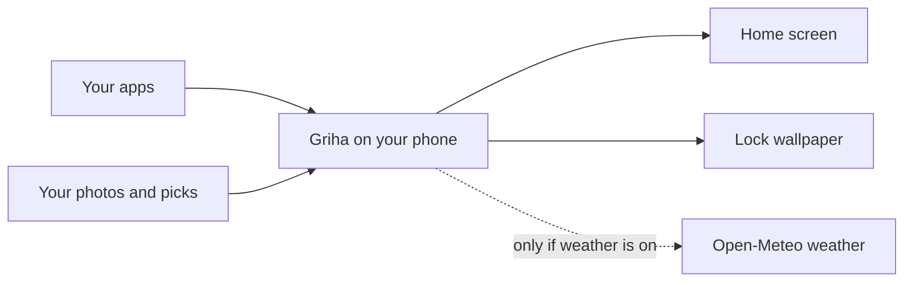

<h1 align="center">
  <br>
  <a href="https://github.com/sudharamachandranrajeev/griha"></a>
  <br>
  Griha
  <br>
</h1>

<h4 align="center">A calm, private home screen for your Android phone, with eight layouts, six 3D themes, a themed lock screen and stickers cut from your photos.</h4>

<p align="center">
  <a href="https://github.com/sudharamachandranrajeev/griha/releases"></a>
  
  <a href="LICENSE"></a>
  <a href="https://github.com/sudharamachandranrajeev/brahma"></a>
</p>

<p align="center">
  <a href="#-what-it-does">What it does</a> •
  <a href="#-get-started">Get started</a> •
  <a href="#-how-it-works">How it works</a> •
  <a href="#-faq-and-troubleshooting">FAQ</a> •
  <a href="#%EF%B8%8F-for-developers">For developers</a>
</p>

**Griha** (गृह, "home") is a home screen launcher: it replaces the screen you see when you press Home
on your phone. It is for people who want a quiet, good-looking home screen that does not track them.
Status: **beta (0.5)**, used daily on one phone. One honest limit: it does not host Android widgets.

## ✨ What it does

- 🏠 **Eight home looks** – Mono, Editorial, Soft cards, Arches, Night list, Dial clock, Soft glass and Dark luxury gold. Switch any time.
- 🧊 **Six surface finishes** – Soft (raised and pressed, lit from the top left), Layered (stacked shadows and an accent glow), Tactile (thick keys with a warm glow), Glass (clear with coloured rims), Carved (dark bevels and an ember glow) and Flat. Cards, buttons, search fields, switches and sliders across home, all apps and settings take the finish you pick.
- 👑 **Luxe home** – gold cards for your day: a schedule checklist, a daily ring, a forgiving streak, a focus mode that hides chosen apps, quotes and a roadmap.
- 👆 **Swipe for all apps** – at the end of home, swipe up for every app; at the top of the list, swipe down to go home. You pick the swipe length and the animation.
- 🔤 **Side alphabet** – in all apps, touch and hold the letters on the right and slide: they swell out around your finger, a bubble shows the letter, and the list jumps to it.
- 🧱 **All apps in 3D** – extruded tiles that stand up on a solid side and sink when pressed, or a 3D wheel where rows turn away toward the edges. Or a flat list.
- 🎨 **Icon theming** – reshape icons (circle, squircle, teardrop), put them on a coloured plate, or use an icon pack made for Nova or ADW.
- 🔒 **Themed lock screen** – Griha draws your lock wallpaper with the date and a greeting, with text effects such as 3D extrusion, glossy glass, gold foil and Witcher steel.
- 🖼️ **Wallpaper sets** – four wallpapers drawn for each look, plus your own pictures or a ZIP wallpaper pack.
- ✂️ **Photo stickers** – pick a photo; Griha cuts out the person or pet on the phone and lets you place it on home.
- 🌦️ **Optional weather** – off until you turn it on, and then it sends only the place you typed.
- ⬆️ **In-app updates** – check for new versions, install them, or roll back to an older one, from Settings. Back up and restore your settings too.

## 🚀 Get started

**Step 1 – Download.** Open the [releases page](https://github.com/sudharamachandranrajeev/griha/releases).

| Platform | File to pick | Works on |
| --- | --- | --- |
| Android phone | `griha-launcher-<version>.apk` | Android 8.0 or later |

Each release lists the file's SHA-256 checksum, so you can check the download is intact.
If no release is listed yet, build it yourself (see **For developers**).

**Step 2 – Install.**

<details>
<summary>Install on Android</summary>

1. Open the downloaded `.apk` file.
2. Android says it cannot install apps from this source. Tap **Settings**, turn on **Allow from this source**, then go back. This appears for any app that does not come from the Play Store.
3. Tap **Install**.

</details>

**Step 3 – Make it your home screen.**

1. Press the phone's **Home** button.
2. Pick **Griha**, then **Always**.
3. If Android does not ask, open **Settings → Apps → Default apps → Home app** and pick **Griha**.

**Step 4 – Set it up.** Touch and hold an empty part of home to open **Settings**. Settings are grouped:

| Group | What is inside |
| --- | --- |
| You and weather | Your name, place, footer line, weather |
| Home screen | Layout, Luxe home, shortcuts, clock |
| Look and theme | Light or dark, surface finish, wallpapers |
| Gestures and motion | Swipe length, all-apps 3D and animation, effects |
| App icons | Icon style, shape, plate, icon packs |
| Lock screen | Themed lock wallpaper and its design |
| Stickers | Cut-out photos on home |
| Updates and versions | Update, roll back, back up and restore settings |
| Android | Default home app |

## 🧭 How it works



- Everything is drawn on the phone. Griha has no account and no server.
- Settings, stickers and Luxe data stay in Griha's private storage on the phone.
- Swipes only count once home or the app list is scrolled to its edge, so they never fight scrolling.

### 🔒 Your data

- **Stays on the phone:** your name, place, favourites, stickers, imported wallpapers, Luxe schedule and focus history.
- **Leaves the phone only when weather is on:** the place you typed and its coordinates go to [Open-Meteo](https://open-meteo.com) about every 30 minutes while home is open. No location permission or device ID is used.
- **Updates:** only when you tap **Check for updates**, Griha asks GitHub for this project's release list; an installer is downloaded only when you pick one, and it must match its published SHA-256 checksum and Griha's signing key.
- **Sticker cut-outs:** found on the phone by Google ML Kit through Play services. The photo is not uploaded; Play services may send Google anonymous usage statistics.
- **Delete everything:** uninstall Griha, or clear its storage in **Settings → Apps → Griha → Storage**.

> [!IMPORTANT]
> Turning on **Theme my lock screen** replaces your current lock-screen picture. Griha cannot bring the old one back, so keep a copy first.

## ❓ FAQ and troubleshooting

<details>
<summary>How do I go back to an older version?</summary>

Open **Settings → Updates and versions**, tap **Check for updates**, then **Roll back to this version** on the one you want. Android only installs an older version after the newer one is removed, so Griha first saves your settings and the older installer to files you choose, then opens Android's page for Griha, where you tap **Uninstall**. Install the saved file, make Griha your home app again, and tap **Restore settings**. Sticker and wallpaper pictures are not kept.
</details>

<details>
<summary>Swiping up opens all apps too easily, or not at all</summary>

Open **Settings → Gestures and motion → Swipe for all apps** and pick a longer or shorter swipe.
The swipe only works once home is scrolled all the way down.
</details>

<details>
<summary>How do I get back to my old home screen?</summary>

Open **Settings → Apps → Default apps → Home app** and pick your old launcher. Griha stays installed until you remove it.
</details>

<details>
<summary>An app is missing from home or all apps</summary>

A Luxe focus session hides the apps you chose until it ends. End the session on the focus card, or wait for its timer.
</details>

<details>
<summary>My icon pack does not show</summary>

Griha reads packs made for Nova, ADW and similar launchers. Apps the pack does not cover keep your chosen shape and plate.
</details>

## 🛠️ For developers

<details>
<summary>Build from source</summary>

You need JDK 17 or later and Android SDK 36. Set `ANDROID_HOME` to the SDK path, then run:

```sh
./gradlew :app:testDebugUnitTest :app:lintDebug :app:assembleDebug
adb install -r app/build/outputs/apk/debug/app-debug.apk
```

The app is plain Kotlin with views built in code: no XML layouts, no AndroidX. Lint treats warnings as errors.
Release builds read a signing key from `.signing/release.properties`, which is never committed.

To publish a version, raise `versionCode` and `versionName` in `app/build.gradle.kts`, then push a tag such as `v0.5.0`, or run the **Release** workflow by hand on `main` (it tags the version itself). Put the notes in `release-notes/<version>.md`. The **Release** workflow tests, lints, signs and publishes `griha-launcher-<version>.apk` with its SHA-256 checksum. It needs four repository secrets: `GRIHA_KEYSTORE_BASE64`, `GRIHA_KEYSTORE_PASSWORD`, `GRIHA_KEY_ALIAS` and `GRIHA_KEY_PASSWORD`. Use the key your installed Griha was signed with, or Android refuses the update.
</details>

## Related

Griha is the home screen of the **Brahma** family of private apps.

| App | What it does |
| --- | --- |
| [brahma](https://github.com/sudharamachandranrajeev/brahma) | The shared core and the all-in-one app |
| [bahya-nireekshana](https://github.com/sudharamachandranrajeev/bahya-nireekshana) | See how much internet data you use |
| [bhandara](https://github.com/sudharamachandranrajeev/bhandara) | See how full your disks are and what fills them |

## License

[MIT](LICENSE)

Fonts under the SIL Open Font License: Cinzel, Dancing Script and UnifrakturCook (see `licenses/`).
Weather from [Open-Meteo](https://open-meteo.com).

---

> GitHub [@sudharamachandranrajeev](https://github.com/sudharamachandranrajeev)
